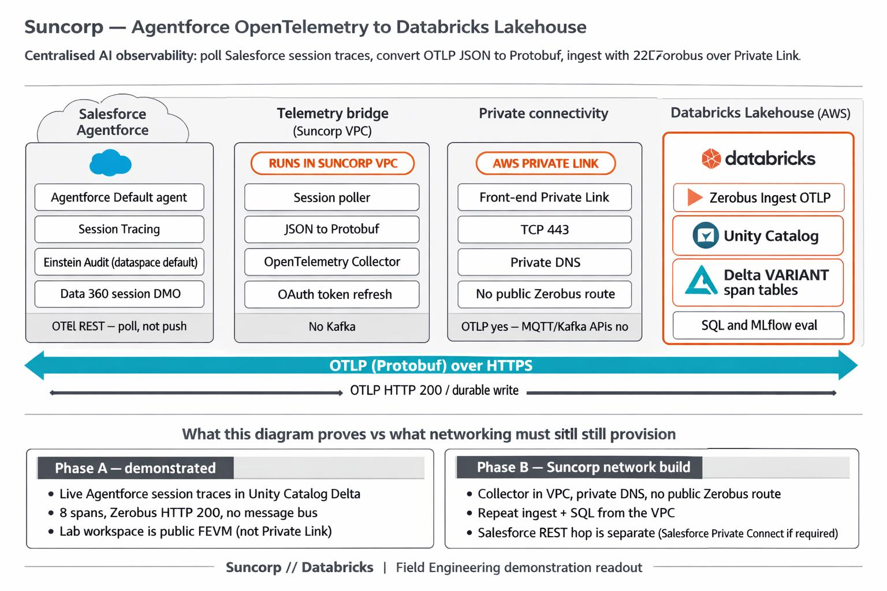

# Architecture — Agentforce OTel → Databricks Zerobus (Suncorp demo)

Bricksmith / Databricks-branded target architecture (Phase A data path plus Phase B Private Link):



Prompt used to generate the figure: [suncorp_agentforce_otel_zerobus.txt](suncorp_agentforce_otel_zerobus.txt) (Bricksmith + Databricks brand style + Unity Catalog / Delta / Databricks logos).

## Production target (four layers)

```
[ Salesforce / Agentforce ]
        |  Session Trace OTel REST API (OTLP JSON, beta)
        |  GET /services/data/v66.0/einstein/audit/otel/{sessionId}
        v
[ Telemetry bridge: poller + OpenTelemetry Collector ]
        |  Poller: discover sessions, JSON->Protobuf
        |  Collector in Suncorp VPC: oauth2clientauthextension token refresh
        |  OTLP Protobuf over Private Link (TCP 443)
        v
[ Databricks Zerobus Ingest OTLP Gateway ]   <- Unity Catalog authz
        |  Header: x-databricks-zerobus-table-name
        |  Direct managed write (no Kafka / Kinesis)
        v
[ Delta Lake tables (VARIANT attributes) ]
        |  Flat, query-ready spans / logs / metrics
        v
[ Lakehouse AI observability / eval / Zero-Copy back to SFDC ]
```

Suncorp workspaces enforce **front-end Private Link**. Zerobus OTLP can use that
path; MQTT/Kafka-compatible Zerobus APIs cannot. See
[docs/suncorp-test-setup.md](suncorp-test-setup.md).

## Why a Collector?

Databricks OAuth tokens for Zerobus expire about every **60 minutes**. The
Collector’s `oauth2clientauthextension` mints and refreshes tokens from a
service principal without changing producer code. In production it also sits
on the **private** hop (VPC → Private Link → Zerobus).

## Why a Poller?

Agentforce does **not** push OTLP to an external endpoint today. The beta
Session Trace OTel API returns one session as OTLP JSON. Production path is:

1. Agentforce writes session/LLM/tool data into Data 360 Session Tracing
2. Poller discovers `ssot__AiAgentSession__dlm` rows
3. Poller fetches each session’s OTel payload
4. Poller converts JSON → Protobuf (Zerobus rejects `application/json`)
5. Poller posts to Collector → Zerobus → Delta

Salesforce evaluation spans may arrive with an **empty `spanId`**. The converter
fills a deterministic 8-byte ID so Zerobus accepts the batch.

## Lab vs production

| | This repo (Phase A) | Suncorp production (Phase B) |
|--|---------------------|------------------------------|
| Databricks | Public FEVM `fevm-ot-pdm-semi` us-east-1 | PL-enforced workspace, same region as producers |
| Zerobus URL | `{workspaceId}.zerobus.us-east-1.cloud.databricks.com` (public) | Front-end / service-direct Private Link, TCP 443 |
| Collector | Optional; lab used **direct Protobuf POST** when Docker was down | Required, in Suncorp VPC, no public Zerobus route |
| Salesforce | OrgFarm DE `orgfarm918` | Suncorp Agentforce + Data Cloud org |
| Proven | Live 8-span ingest, SQL on Delta | Not yet — needs network build |

## Demo environment (this repo)

| Layer | Choice |
|-------|--------|
| Salesforce | OrgFarm Dev Edition `orgfarm-91850b6147-dev-ed` |
| Databricks | FEVM AWS Serverless `fevm-ot-pdm-semi` (us-east-1) |
| Catalog | `ot_pdm_semi_catalog.agentforce_otel` |
| Tables | `agentforce_otel_{spans,logs,metrics}` |
| Ingest used | Direct Zerobus OTLP/HTTP Protobuf (Collector YAML still in-repo for prod) |
| Auth | Databricks SP `agentforce-zerobus-otel` (table-level `SELECT`+`MODIFY`) |
| Live session | `01a16cb0-5079-71ce-a37e-9aee0cb3c332` (24 Oct 2026) |

## Key advantages for Suncorp

1. **No message bus** — no Kafka/MSK/Kinesis for lakehouse-bound telemetry
2. **Private Link compatible** — OTLP is a supported Zerobus PL interface
3. **Unified AI eval** — LLM-as-judge / RAG evals on live conversation traces
4. **Zero-Copy optionality** — share curated analytics back to Salesforce Data Cloud
5. **VARIANT columns** — preserve high-cardinality Agentforce prompt/tool metadata

## References

- [Zerobus OTLP overview](https://docs.databricks.com/aws/en/ingestion/opentelemetry/)
- [Configure OTLP clients](https://docs.databricks.com/aws/en/ingestion/opentelemetry/configure)
- [OTLP table reference](https://docs.databricks.com/aws/en/ingestion/opentelemetry/table-reference)
- [Zerobus networking / front-end Private Link](https://docs.databricks.com/aws/en/ingestion/zerobus-networking)
- [Inbound PrivateLink for performance-intensive services](https://docs.databricks.com/aws/en/security/network/front-end/service-direct-privatelink)
- [Agentforce Session Trace OTel API](https://developer.salesforce.com/docs/ai/agentforce/guide/otel-api.html)
